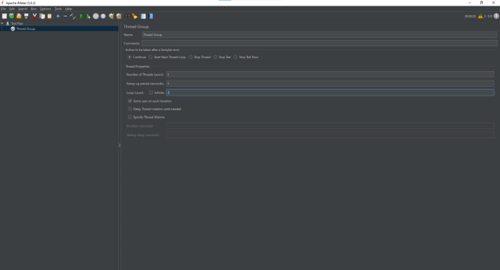
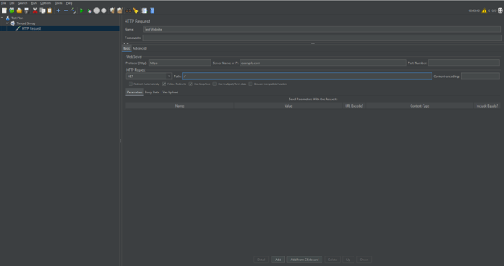
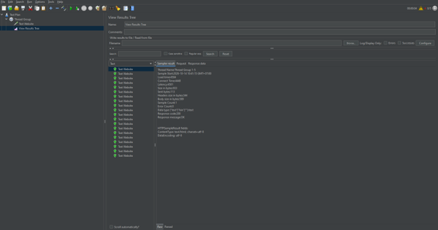
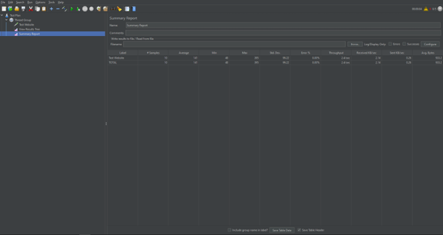

# BÁO CÁO THỰC HÀNH APACHE JMETER

## 1. Giới thiệu

Apache JMeter là công cụ mã nguồn mở được sử dụng để kiểm thử hiệu năng và kiểm thử tải cho website, API và các hệ thống phần mềm.

Mục tiêu của bài thực hành là tìm hiểu cách sử dụng Apache JMeter, xây dựng kịch bản kiểm thử HTTP, mô phỏng nhiều người dùng đồng thời và đánh giá kết quả phản hồi của hệ thống.

## 2. Công cụ và môi trường thực hành

- **Công cụ kiểm thử:** Apache JMeter 5.6.3.
- **Hệ điều hành:** Windows.
- **Giao thức:** HTTPS.
- **Phương thức HTTP:** GET.
- **Website kiểm thử:** https://example.com.

## 3. Nội dung thực hành

### 3.1. Cấu hình Thread Group

Thread Group được sử dụng để cấu hình số lượng người dùng giả lập, thời gian khởi chạy và số vòng lặp của kịch bản kiểm thử.

Thông số cấu hình:

- Number of Threads (users): 5.
- Ramp-up period (seconds): 5.
- Loop Count: 2.

Với cấu hình này, số lượng yêu cầu dự kiến là 10 nếu tất cả người dùng hoàn thành đủ hai vòng lặp.

**Hình 1. Cấu hình Thread Group**

### 3.2. Cấu hình HTTP Request

HTTP Request được sử dụng để gửi yêu cầu đến máy chủ web nhằm kiểm tra khả năng phản hồi.

Thông số cấu hình:

- Name: Test Website.
- Protocol: HTTPS.
- Server Name or IP: example.com.
- Method: GET.
- Path: /.

**Hình 2. Cấu hình HTTP Request**

### 3.3. Theo dõi kết quả bằng View Results Tree

View Results Tree cho phép theo dõi kết quả từng yêu cầu HTTP, bao gồm trạng thái phản hồi và nội dung máy chủ trả về. Thành phần này hỗ trợ phát hiện các yêu cầu thành công hoặc thất bại trong quá trình kiểm thử.

**Hình 3. Kết quả kiểm thử bằng View Results Tree**

### 3.4. Tổng hợp kết quả bằng Summary Report

Summary Report cung cấp các chỉ số tổng hợp trong quá trình kiểm thử, bao gồm:

- **Samples:** Tổng số yêu cầu đã thực hiện.
- **Average:** Thời gian phản hồi trung bình.
- **Min:** Thời gian phản hồi nhỏ nhất.
- **Max:** Thời gian phản hồi lớn nhất.
- **Error %:** Tỷ lệ yêu cầu xảy ra lỗi.
- **Throughput:** Số lượng yêu cầu được xử lý trong một đơn vị thời gian.

**Hình 4. Báo cáo tổng hợp Summary Report**

## 4. Kết quả kiểm thử và đánh giá

Kết quả kiểm thử được ghi nhận thông qua Summary Report của Apache JMeter.

| Chỉ số | Kết quả thực tế |
|---|---|
| Tổng số yêu cầu (Samples) | Điền theo kết quả JMeter |
| Thời gian phản hồi trung bình (Average) | Điền theo kết quả JMeter |
| Thời gian phản hồi nhỏ nhất (Min) | Điền theo kết quả JMeter |
| Thời gian phản hồi lớn nhất (Max) | Điền theo kết quả JMeter |
| Tỷ lệ lỗi (Error %) | Điền theo kết quả JMeter |
| Throughput | Điền theo kết quả JMeter |

### Nhận xét

Thông qua quá trình thực hành, Apache JMeter giúp theo dõi trạng thái phản hồi của website và tổng hợp các chỉ số hiệu năng cơ bản. Kết quả được đánh giá dựa trên số lượng yêu cầu, thời gian phản hồi, tỷ lệ lỗi và thông lượng ghi nhận trong quá trình chạy thử.

Phạm vi thực hành này mang tính cơ bản, chưa đủ để kết luận về khả năng chịu tải tối đa của hệ thống.

## 5. Kết luận

Qua bài thực hành, em đã tìm hiểu cách xây dựng Test Plan, cấu hình Thread Group, thiết lập HTTP Request và sử dụng View Results Tree cùng Summary Report để theo dõi, tổng hợp kết quả kiểm thử bằng Apache JMeter.

Bài thực hành giúp củng cố kiến thức về kiểm thử hiệu năng và làm quen với quy trình xây dựng kịch bản kiểm thử tải cho website.

## 6. Tài liệu tham khảo

1. [Apache JMeter - Getting Started](https://jmeter.apache.org/usermanual/get-started.html)
2. [Apache JMeter - Building a Web Test Plan](https://jmeter.apache.org/usermanual/build-web-test-plan.html)
3. [Apache JMeter - Test Plan Elements](https://jmeter.apache.org/usermanual/test_plan.html)

## 7. Repository bài thực hành

Repository lưu trữ báo cáo, hình ảnh minh họa và các tài liệu liên quan đến bài thực hành Apache JMeter.
